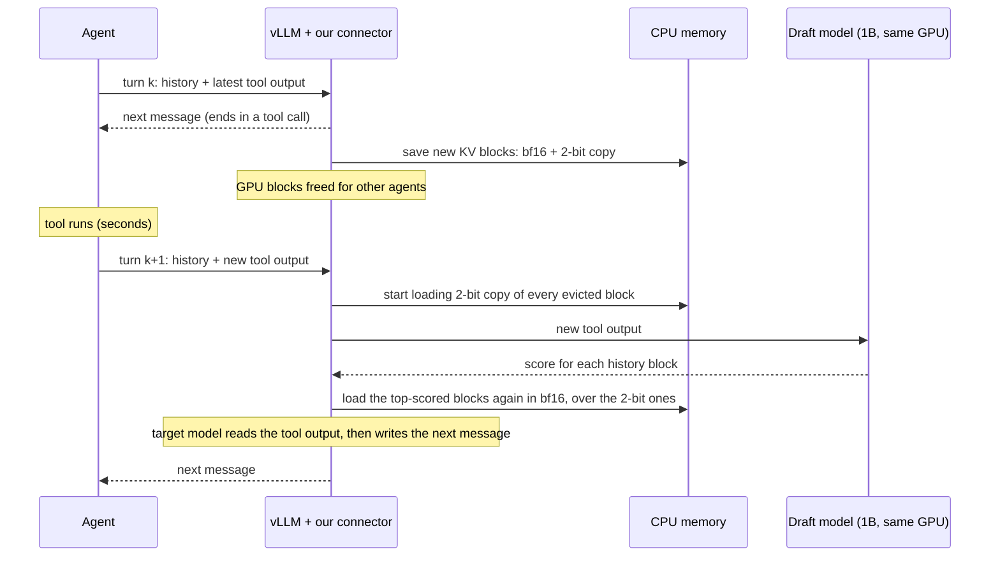

# 2. The idea

## In one sentence

**Offload an agent's KV cache to CPU memory while its tool runs. When the tool returns, have a
small draft model predict which history blocks the next step will need, and reload those at full
precision and the rest at 2-bit.**

Every token comes back, so nothing is permanently lost. Only the precision of the reloaded copy
changes, and with it the number of bytes that must cross PCIe before the agent can continue.

## A turn, step by step



### 1. Pause: save

When an agent's request finishes, our vLLM connector copies each new full KV **block** (16 tokens
of every layer) to pinned CPU memory twice: once in bf16 (the original) and once quantized to 2
bits. Quantization uses the KIVI recipe: keys per channel, values per token, fp16 scales. vLLM
can then hand the GPU blocks to other agents. While GPU memory is not needed, vLLM keeps the
blocks cached on the GPU as well, and nothing has to be reloaded.

### 2. Tool returns: score

The draft model is **Llama-3.2-1B** for a **Llama-3.1-8B** target. Both use the same tokenizer,
so their blocks line up exactly. The draft keeps its own KV cache for the agent's whole history
on the GPU; at 32 KB/token it is a quarter of the target's. When the tool output arrives, the draft:

1. reads the new tool output on top of its history;
2. writes **N = 4 short guesses (L = 10 tokens each)** of what the agent will say next;
3. scores every history token by how much the guesses attend to it. This is the **consensus
   score** from Phase 1:

   ```
   S_i = (1/N) · Σ_j  max_t  A_j[t, i]
   ```

   where `A_j[t, i]` is the attention (averaged over layers and heads) from step `t` of guess `j`
   to history token `i`;
4. sums token scores into block scores.

So the scores do not come from the tool output alone. The tool output shapes the guesses, and
the guesses reveal which earlier context the next step will reach for. In Phase 1 this lookahead
found about **52%** of the tokens the real next message needed most, against 32% for looking back
at recent attention (SnapKV-style) and 10% at random. Cheaper alternatives (tool-output-only
attention, SpecPrefill's scoring) are compared in the gate experiment.

### 3. Reload: load-then-upgrade

To keep the draft off the critical path, loading starts **before** scoring finishes:

1. Load the 2-bit copy of every evicted block and dequantize it into ordinary bf16 vLLM blocks.
2. In parallel, the draft scores the blocks.
3. Overwrite the top-k% blocks with their bf16 originals.
4. Tell vLLM the load is done. The target model then reads the new tool output on top of this
   mixed-precision history and continues normally.

These blocks always come back in bf16: **block 0**, which holds the *attention sinks*, and the
**most recent 64 tokens**.

## Where the savings come from

Every block crosses PCIe at its chosen precision. For Llama-3.1-8B with 16-token blocks,
including the fp16 scales, and ignoring the few blocks that are always bf16:

| Reload | Bytes vs. bf16 |
|---|---|
| everything bf16 (today's CPU offload) | 1.00 |
| everything 4-bit | 0.32 |
| everything 2-bit | 0.20 |
| 10% bf16, 90% 2-bit | 0.28 |
| 20% bf16, 80% 2-bit | 0.36 |

The GPU-side KV cache is **not** compressed: reloaded blocks are ordinary bf16 vLLM blocks, so
attention runs on vLLM's unmodified kernels. The savings are in **PCIe bytes and time per resume**,
in **CPU memory**, and in **how many agents can resume at once** before the link saturates.

The table also shows the main risk. Uniform 4-bit (0.32) moves about the same bytes as
"10–20% bf16 + 2-bit" and needs no draft at all. The draft is only worth having if it buys
noticeably better quality at the same bytes, or the same quality with fewer. That is exactly what
the [gate experiment](05-benchmarks.md#benchmark-1-gate-experiment-offline) decides.

## Why keep every token

- **Quality.** In Phase 1, quantizing the unselected tokens to 2-bit instead of evicting them did
  7× less damage when 10% were kept and 18× less when 20% were kept. Quantizing everything to
  2-bit cost only +0.054 nats/token.
- **Engineering.** If every token is present, positions and attention are unchanged and vLLM
  needs no modification. Dropping tokens would need a sparse KV cache, which vLLM does not have.
  Its maintainers declined native support for SpecPrefill for exactly this reason
  ([vllm-project/vllm#39060](https://github.com/vllm-project/vllm/issues/39060)).

## Design decisions and rejected alternatives

| Decision | Alternative we rejected | Why |
|---|---|---|
| Change precision on **reload** (PCIe/CPU) | Keep a mixed-precision KV cache **on the GPU** (the original proposal) | Attention kernels would have to read mixed precision per block, which means custom kernels. Keeping it simple is a hard constraint. |
| **Quantize** the unselected blocks | **Skip** them (sparse reload) | Eviction-level quality loss, plus position re-encoding (RoPE) and changes to vLLM internals |
| Run the draft **inside vLLM's worker**, owned by our connector | vLLM's built-in speculative-decoding drafter | That drafter runs *after* the target in each step, and its KV shares block ids with the target, so it would be offloaded together with the target's |
| **Llama-3.1-8B / Llama-3.2-1B** | Qwen3-8B / Qwen3-0.6B | The Qwen3 draft's KV is 112 KB/token vs. 144 KB/token for the target, only 1.3× smaller. The Llama draft is 4× smaller. |
| Lossy precision choice | Lossless only | Lossless prefill needs every block at full precision anyway, so the draft would add nothing |
| Plain PyTorch plus vLLM plugin points | Fork vLLM, write Triton kernels | Simplicity, and every baseline runs on the same unmodified engine |

## How the idea evolved

1. **Proposal (v1):** under GPU memory pressure, run N draft rollouts, score tokens by
   consensus attention, and keep the top tokens in bf16 and the rest at 2 or 4 bits, **in GPU
   memory** ([`proposal/proposal.tex`](../proposal/proposal.tex)).
2. **Phase 1 findings:** consensus scoring works (52% recall) and quantizing beats evicting by
   7–18×. But uniform 2-bit is already cheap in quality, and mixed precision on the GPU needs
   custom kernels.
3. **Current direction (v2):** apply the same scoring at a natural moment, the **tool-call pause**,
   and to a different resource: the bytes **reloaded from CPU**. The notes in
   [`TEMP.md`](../TEMP.md) on TriForce-style retrieval and CPU offload led here.

Next: [Goals](03-goals.md).
