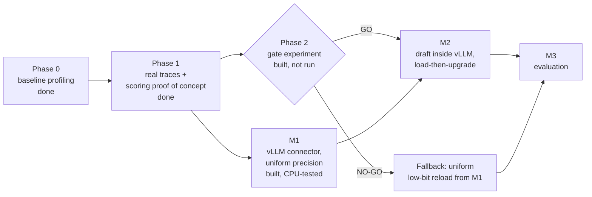

# 4. Phases

Each phase answers one question and decides what the next phase builds.

---

## Phase 0

**Question:** does a plain, unoptimized KV cache really become a problem under an agent-like
workload?

**What was done.** [`src/baseline_experiment.py`](../src/baseline_experiment.py) loads
Llama-3.2-1B-Instruct with Hugging Face `transformers` and no KV optimizations. It then simulates
an agent: each turn appends a real tool output to the context, keeps the KV cache, and generates
64 tokens.

| Run | Data | Turns | Final context |
|---|---|---|---|
| SWE-bench (django-10554) | tool outputs from one real coding-agent run | 126 | 35,293 tokens |
| SWE-bench (sympy-14248) | tool outputs from one real coding-agent run | 108 | 34,993 tokens |
| ALFWorld | 36 household-task games joined together | 514 | 48,030 tokens |
| Synthetic | filler text (smoke test only) | 500 | 144,000 tokens |

**Findings**
- GPU memory in use grows linearly with context: 2.3 GB of weights to 3.4 GB at 35k tokens.
- PyTorch *reserves* far more than it uses. On ALFWorld it reserved 19.1 GB for 3.8 GB in use.
  The fragmentation comes from temporary attention buffers.
- Decoding slows as context grows: 124 to 74 tokens/s at 144k (synthetic).

**Limitations.** The context held only tool outputs, not the task or the agent's real messages,
and the KV size was not measured directly. Phase 1 fixed both.

**Code and results:** [`src/`](../src/), [`data/`](../data/), [`results/`](../results/).

---

## Phase 1

**Questions:** (1) how do memory and speed behave with the full, real agent conversation?
(2) Can draft guesses identify the tokens that matter, and is quantizing better than evicting?

**Setup:** Google Colab T4 GPU, `unsloth/Llama-3.2-1B-Instruct` in fp16. Data: 10 real
mini-SWE-agent runs on SWE-bench Verified, the longest run from each of 10 projects, 18k–56k
tokens (see [Benchmarks](05-benchmarks.md#workload-real-agent-recordings)).

**Experiment 1: full-conversation replay.** Each run is replayed turn by turn with the system
prompt, task, the agent's real messages and the real tool outputs.
- The KV cache is exactly **32 KB/token** on every turn of every run (1.71 GB at 56k).
- Decoding slows from about **42 to 3.3 tokens/s** at 56k, about 13×. Reading 1,000 new tokens
  costs about 200 ms early on and about 1,400–1,500 ms at 40k–55k.
- About 14 GB is reserved for about 4 GB in use.
- The Phase 0 method undercounts real context by about 12%.

**Experiment 2: consensus scoring proof of concept.** Three runs were cut at about 2k–5k tokens,
giving 12 contexts, each just before a real agent message. Each method chose the top 5/10/20/40%
of tokens. The rest were either quantized to 2-bit or evicted, and the damage to the real next
message was measured. The draft was the same 1B model as the target.

| Result | Number |
|---|---|
| Share of the truly needed tokens found (top 10%) | consensus N=4: **52%**; SnapKV-style (look back): 32%; random: 10% |
| Damage, keep 10%: quantize vs. evict (consensus N=4) | +0.043 vs. +0.317 ΔNLL (**7×** less) |
| Damage, keep 20% | +0.007 vs. +0.123 (**18×** less) |
| Everything at 2-bit, nothing kept | +0.054 ΔNLL |
| More guesses (N=1 to 8) | Helps under eviction, little effect under quantization |
| Where the important tokens are | The agent's own recent messages: 40–42% of the top 10%, though only 8–19% of the context |

**What it changed:** quantizing beats evicting (keep every token), and lookahead scoring works.
But uniform 2-bit is already cheap, so a draft must earn its cost. That led to the gate and to the
v2 design ([The idea](02-idea.md#how-the-idea-evolved)).

**Code and results:** [`Phase_1/`](../Phase_1/). Its README has every graph explained.

---

## Phase 2: gate experiment

**Question:** at equal reload bytes, does draft-guided precision beat uniform 4-bit, with the
real 8B target and 1B draft? This is RQ1 and RQ2 in [Goals](03-goals.md).

**What it does:** it replays 31 tool-call pauses (histories of 8k–34k tokens) offline in
`transformers`. For each pause it reloads the history at every precision scheme, reads the tool
output on top, and measures the damage to the real next agent message against the bytes. The
decision rule is fixed in code before any run. Full protocol:
[Benchmarks](05-benchmarks.md#benchmark-1-gate-experiment-offline).

**Status:** built and dry-run on CPU with tiny random models. Not run on a GPU yet; it needs one
A100 for roughly 30–60 minutes (our estimate).
**Code:** [`kv_manager/experiments/gate/`](../kv_manager/experiments/gate/).

---

## M1: vLLM system without the draft

**Goal:** a working offload-and-reload system inside vLLM 0.27.1, with uniform precision modes
(`bf16`, `uniform_int4`, `uniform_int2`) and the benchmark harness. It is useful on its own and is
the fallback if the gate says no.

**Built:**
- `AgentKVConnector`, a vLLM KV connector plugin: save at request end, asynchronous
  mixed-precision reload, CPU slots keyed by vLLM's block hashes.
- Shared quantization code with the gate.
- A replay benchmark of N concurrent agents.
- Launch scripts for both baselines.

Details are in [Architecture](06-architecture.md).

**Status:**
- 22 CPU unit tests pass.
- A code review against the vLLM source found four bugs, all fixed: an abort-during-load crash,
  blocking transfers, oversized pinned memory, and lossy blocks overwriting originals.
- **Not yet run on a GPU.** First step: `run_systems.sh "vllm kvm_bf16" --agents 4`.

---

## M2: the draft inside vLLM (planned)

- Load the 1B draft inside vLLM's worker process, owned by the connector, with per-session draft
  KV on the GPU.
- At save time, the draft reads the agent's new message (off the critical path).
- At reload: start the 2-bit load, score with the draft, upgrade the top blocks to bf16, then
  report the load done.
- Modes: `draft` (consensus), `specprefill`, `recency`, `random`.

The design is fixed (see [Architecture](06-architecture.md#m2-the-draft-inside-the-connector)).
It is built only if the gate says GO.

## M3: evaluation (planned)

- Concurrency sweeps (agents × GPU KV budget × tool-delay distribution) for all systems.
- Ablations: scorer, keep fraction, block size, recent-window size.
- Quality inside vLLM through forced decoding: a logits-processor plugin that forces the real next
  message and reads its log-probabilities.
- Plots and the paper's main tables.
